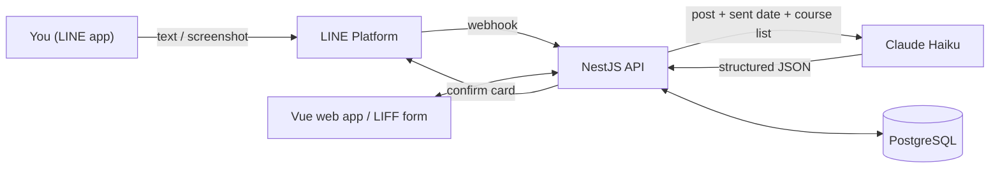

# LINE Assignment Tracker

LINE bot + web app that turns Google Classroom posts and screenshots into assignment cards with deadlines, using Claude AI.

Forward a post to the bot, check the card it builds, tap **Confirm** — the assignment lands on your board and calendar.

<!-- Screenshots: add images to docs/ and link them here, e.g.  -->

## Features

- **Screenshot or text in, structured card out**
  - Claude reads Thai or English posts and extracts title, course, type, start date, due date and details.
- **Confirm before saving**
  - The bot replies with a card: **Confirm**, **Edit** (a form that opens inside LINE via LIFF), or **Cancel**.
  - Nothing reaches the board until you confirm.
- **Smart date handling**
  - "Next Friday" and "พรุ่งนี้" are resolved from the date the message was sent.
  - Buddhist Era years are converted (2569 → 2026).
  - Posts with no time default to 23:59 (Asia/Bangkok).
- **Course matching**
  - Posts are matched to your course list by code, name or professor.
  - A course the bot hasn't seen before is added automatically when you confirm.
- **Web dashboard**
  - **Board** — cards grouped by status.
  - **Calendar** — bars run from start date to deadline. Drag a bar to change its dates.
  - **Upcoming** — overdue, today, this week and later.
  - **Courses** — colour-coded course list.
- **Private by design**
  - LINE Login with an allow-list of accounts.
  - Each user only sees their own data.
- **Low cost**
  - The bot answers with free LINE reply messages, so it doesn't use the monthly message quota.
  - It uses the fastest, cheapest Claude model.

## How it works



1. **Webhook check** — the webhook verifies LINE's signature, answers LINE immediately, then processes the message in the background.
2. **Extraction** — Claude returns JSON in a fixed format (structured outputs). The API then re-checks every value: course IDs must exist, dates must be real dates, and start ≤ due.
3. **Draft card** — the result is saved as a **draft** and sent back to you as a Flex Message card.
4. **Confirm** — **Confirm** turns the draft into a card on the website. **Edit** opens the LIFF form so you can fix it first.

## Tech stack

| Part | Tech |
|---|---|
| Backend | NestJS 11, Prisma 6, PostgreSQL 16 |
| Frontend | Vue 3, Vite, Tailwind CSS 4, FullCalendar |
| LINE | Messaging API (webhook, Flex Messages), LINE Login + LIFF |
| AI | Claude API (`claude-haiku-5-5`, vision + structured outputs) |
| Deploy | Docker Compose, Caddy (automatic HTTPS) |

---

## Project layout

```
line-assignment-tracker/
├─ .env.example        all settings (copy to .env)
├─ docker-compose.yml  database (dev) + full app (prod)
├─ api/                NestJS + Prisma + PostgreSQL
│  ├─ prisma/schema.prisma      users, courses, assignments
│  ├─ src/line/                 webhook, confirm card, LINE API calls
│  ├─ src/extraction/extract.ts Claude prompt + result checks
│  ├─ src/assignments/, courses/, auth/
│  └─ test/core.test.ts         unit tests (npm test)
└─ web/                Vue 3 + Vite + Tailwind + FullCalendar
   ├─ src/views/       Board, Calendar, Upcoming, Courses, Login, LIFF edit page
   └─ Caddyfile        production web server (HTTPS + /api proxy)
```

---

## 1. Run it on your computer (no LINE needed yet)

**You need:** Node.js 22, Docker Desktop.

- **Settings**
  - Copy `.env.example` to `.env` in this folder.
  - For now, only the database lines matter. Keep `DEV_LOGIN_LINE_USER_ID` as it is.
- **Database**
  ```
  docker compose up -d db
  ```
- **API** (first terminal)
  ```
  cd api
  npm install
  npm run db:migrate -- --name init
  npm run start:dev
  ```
  - `db:migrate` creates the tables and the `api/prisma/migrations` folder. Keep that folder; production uses it.
  - The API runs on http://localhost:3000/api.
- **Website** (second terminal)
  ```
  cd web
  npm install
  npm run dev
  ```
  - Open http://localhost:5173 and click **Dev login (local only)**.
  - You can add courses and cards by hand to check the pages.
- **Tests**
  ```
  cd api
  npm test
  ```

---

## 2. Set up LINE (one time)

Both LINE channels must be under the **same provider**, otherwise the user IDs from the bot and from the website login won't match.

### a. Bot — Messaging API channel

- **Create it**
  - LINE no longer lets you create a Messaging API channel directly in the Developers Console.
  - Create a **LINE Official Account** in LINE Official Account Manager.
  - Then go to Settings → Messaging API → **Enable**, and pick your provider. The provider can't be changed later.
- **In LINE Official Account Manager**
  - Response settings: turn **Chat** off, **Webhooks** on, **Auto-response** off, **Greeting message** off.
- **In LINE Developers Console → your Messaging API channel**
  - Basic settings → copy **Channel secret** → `LINE_CHANNEL_SECRET`.
  - Messaging API → issue a **Channel access token (long-lived)** → `LINE_CHANNEL_ACCESS_TOKEN`.
  - Messaging API → Webhook URL: `https://<your-domain>/api/line/webhook`. Turn **Use webhook** on.

### b. Website login + Edit form — LINE Login channel with a LIFF app

- **Create it** — in the same provider, create a **LINE Login** channel (app type: Web app).
  - Copy the **Channel ID** → `LINE_LOGIN_CHANNEL_ID`.
- **Add a LIFF app** (LIFF tab)
  - Size: **Full**.
  - Endpoint URL: `https://<your-domain>/` (must be HTTPS).
  - Scopes: **openid** and **profile**.
  - Copy the **LIFF ID** → `LIFF_ID`.
- **Callback URL** (LINE Login tab) — `https://<your-domain>/`
- **Status**
  - New channels are "Developing", and only Admin/Tester roles can log in.
  - Either add your friend as a Tester, or switch the channel to **Published**. Publishing can't be undone, but the allow-list in `.env` still keeps everyone else out.

### c. Claude API key

- Create a key in the Claude Console → `ANTHROPIC_API_KEY`.
- The default model `claude-haiku-5-5` is the fastest and cheapest, and it reads screenshots.

### d. Allow your two LINE accounts

- Add the bot as a friend and send it any message.
- Because you're not on the list yet, it replies with your **LINE user ID**.
- Put both IDs in `ALLOWED_LINE_USER_IDS=Uxxx,Uyyy` and restart the API.

---

## 3. Test the bot from your computer (before deploying)

LINE needs a public HTTPS URL. A tunnel gives you one temporarily.

- **Start a tunnel** to the website dev server (it forwards `/api` to the API):
  ```
  cloudflared tunnel --url http://localhost:5173
  ```
  It prints a URL like `https://abc-def.trycloudflare.com`.
- **Point everything at the tunnel URL**
  - Webhook URL → `https://abc-def.trycloudflare.com/api/line/webhook`
  - LIFF Endpoint URL and Login Callback URL → `https://abc-def.trycloudflare.com/`
  - In `.env`, set `WEB_URL=https://abc-def.trycloudflare.com`, then restart the API.
- **Try it** — send a Classroom screenshot to the bot.

---

## 4. Deploy (any small Linux VPS with Docker)

- **Domain** — point your domain (A record) at the server.
- **Copy the project** to the server, including `api/prisma/migrations`.
- **`.env`** on the server
  - Set `DOMAIN`, a strong `POSTGRES_PASSWORD`, and a long random `SESSION_SECRET`.
  - Fill in all the LINE and Claude values.
  - `DATABASE_URL` and `WEB_URL` are set automatically by docker compose.
- **Start**
  ```
  docker compose --profile prod up -d --build
  ```
  - Caddy gets the HTTPS certificate automatically.
  - The API applies database migrations on start.
- **Update the LINE settings** to the real domain: Webhook URL, LIFF Endpoint URL, and Callback URL. Then use **Verify** on the webhook.

---

## How it works

- **Extraction**
  - The bot sends Claude the post (text or image), the date and time it was sent, and your course list.
  - Claude returns structured JSON. The API then re-checks every value: course IDs must be real, dates must be valid, Buddhist Era years (2569) become 2026, and a deadline before the start date moves the start date.
- **Dates**
  - Start date defaults to the day you sent the post.
  - If the post has no time, the due time is 23:59 Bangkok time and the card shows the date only.
  - All times are Asia/Bangkok.
- **New courses**
  - If the post names a course that isn't in your list, the card shows it as "(new)". It's created when you confirm.
- **Drafts**
  - Until you tap Confirm, a card is a draft and doesn't appear on the website.
  - The bot can't confirm a card that has no due date. Use Edit to add one.
- **LINE costs**
  - Replies are free and don't use the monthly message quota.
  - The bot only uses a push message (which counts toward the quota) if a reply token has expired.
- **Screenshots** are stored in `UPLOAD_DIR` and shown on the card under "Original screenshot".

## Useful commands

| What | Command (in `api/`) |
|---|---|
| Browse the database | `npm run db:studio` |
| New migration after editing `schema.prisma` | `npm run db:migrate -- --name <change>` |
| Unit tests | `npm test` |
